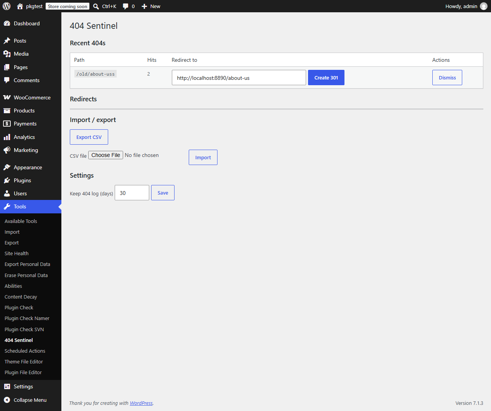

# Redirect & 404 Sentinel

Logs 404 errors, suggests the closest matching page, and turns any of them into a 301 redirect in one click.

   



## Features
- 404 log with hit counts and a retention window (default 30 days). No IP addresses or user agents are stored.
- Closest-match suggestion by slug similarity, pre-filled in the redirect field.
- One-click 301 redirects, with loop and self-redirect detection.
- CSV import and export (formula-injection safe).
- WP-CLI commands.
- Zero extra queries on normal page views. A 404 costs about 3 extra queries.
- Log growth is capped (10,000 distinct paths by default).

## Installation
**Zip:** download `redirect-404-sentinel-1.0.0.zip` from Releases, then Plugins > Add New > Upload.
**Manual:** copy the `redirect-404-sentinel` folder to `wp-content/plugins/` and activate it.

## Usage
Open **Tools > 404 Sentinel**. Pick or edit the target next to a logged 404 and click **Create 301**.

## WP-CLI
```bash
wp sentinel list --limit=20
wp sentinel redirect /old-url /new-url
wp sentinel prune
```

## Hooks
See [docs/hooks.md](docs/hooks.md).

## FAQ
**Does it redirect pages that exist?** No. Redirects apply only to requests that would 404, so normal pages are never touched.
**Is data sent anywhere?** No. There are no external services and no tracking.

## Development
```bash
composer install
composer lint && composer stan && composer test:unit
npx @wordpress/env start
npx @wordpress/env run tests-cli --env-cwd=wp-content/plugins/redirect-404-sentinel phpunit -c phpunit.xml.dist
```
The WordPress suite needs PHPUnit 9.6 and `yoast/phpunit-polyfills` inside the container. See [TESTING.md](TESTING.md).

## Roadmap
Regex rules, 410 responses, per-redirect hit counts.

## Contributing
See [CONTRIBUTING.md](CONTRIBUTING.md). Security reports: [SECURITY.md](SECURITY.md).

## License
GPL-2.0-or-later.